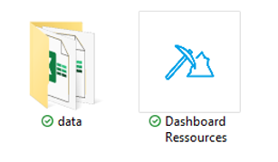
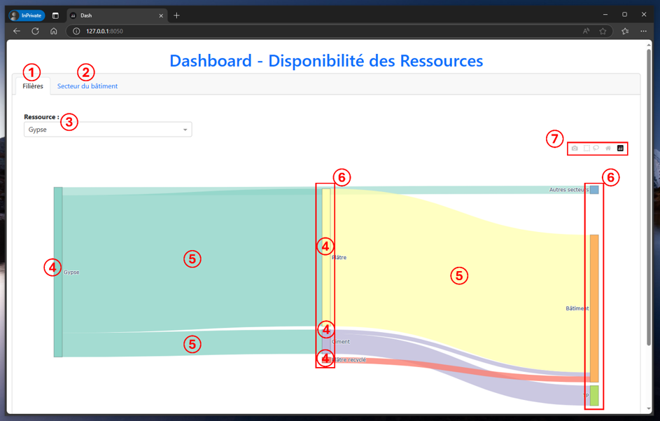
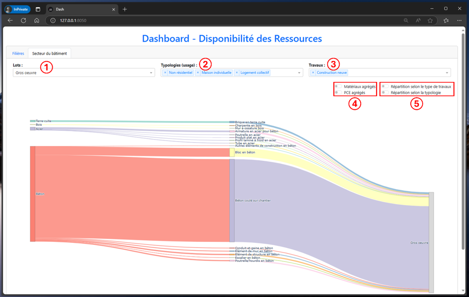

# BAREM


## Présentation

L’outil BAREM permet de visualiser les flux de matières dans un diagramme de Sankey à partir d’un fichier EXCEL au bon format. Cet outil a été développé dans le cadre du projet « Analyse de la disponibilité prospective des ressources » par le CSTB pour le compte de l’ADEME. L’objectif initial de l’outil était de visualiser les flux de consommation de matière du secteur du bâtiment ainsi que les consommations de matières multi-sectorielles pour 3 filières matériaux, l’acier, le gypse et le sable (ou granulats). 

Cette documentation décrit l’ensemble des étapes permettant d’utiliser l’outil de visualisation sur son ordinateur.

## Utilisation

### 1. Installation et Lancement
L’application est livrée sous forme d’un fichier compressé .zip, qui contient un exécutable Dashboard *Ressources.exe*, et un dossier *data/* avec deux fichiers Excel : *filieres.xlsx* et *batiment.xslx*.

Pour installer l’application, double-cliquer sur le .zip, ce qui devrait ouvrir la fenêtre d’un logiciel d’extraction. Sélectionner les deux éléments (le *.exe* et le dossier *data/*), cliquer sur « Extraire », et choisir un emplacement de destination sur le PC. Il est ensuite possible de déplacer les deux éléments, tant qu’ils se trouvent au même emplacement (par exemple, dans un dossier *Ressources/* créé au préalable).


 
Pour lancer l’application, double-cliquer sur le *.exe*. Il est possible qu’une fenêtre Windows s’ouvre avec le message « Windows a protégé votre ordinateur ». Pour contourner cela, cliquer sur « Informations complémentaires », puis sur « Exécuter quand même » : cette manipulation n’est à faire qu’une fois. Une fois l’application lancée, une fenêtre du navigateur par défaut (par exemple : Edge) s’ouvrira au bout de quelques secondes. Celle-ci contient le Dashboard, qui représente les données contenues dans les fichiers du dossier *data/*.

**IMPORTANT** : Ces deux fichiers ne doivent être ni renommés, ni supprimés. Au moment de lancer l’application, ils ne doivent pas être ouverts.

En option : Il est également possible de créer un raccourci sur le bureau pour lancer plus facilement l’application. Pour cela, faire un clic-droit sur le fichier exécutable (*.exe*) et sélectionner > Créer un raccourci, puis coller le raccourci sur le bureau. Ne pas déplacer les données (dossier *data/*) lors de ce processus.


### 2. Utilisation du Dashboard

<figure>
    
    <figcaption>Figure 1 - Fenêtre de navigateur ouverte au lancement de l'application, onglet « Filières »</figcaption>
</figure>

Le Dashboard présente deux onglets :
-	« Filières » (1 sur la Figure 1) permet de visualiser les flux de matière et leur utilisation par différentes filières. 
-	« Secteur du bâtiment » (2 sur la Figure 1) permet de visualiser les flux de matières pour le secteur de bâtiment, séparés par type de lots (gros œuvre, second œuvre et équipements).

Quelques concepts généraux et outils à retenir : 
-	Les nœuds (représentés par des rectangles sur les diagrammes, 4 sur la Figure 1) représentent la source ou la cible d’un flux (5 sur la Figure 1) : un matériau, un produit, un secteur, etc. Les flux sont donc toujours compris entre deux nœuds.
-	Les nœuds sont regroupés en étages (6 sur la Figure 1), qui représentent des types de nœuds. Tous les nœuds d’un même étage sont placés sur la même ligne verticale.
-	Tous les diagrammes présentent des fonctionnalités communes, activables avec les icônes en gris en haut à droite du diagramme (7 sur la Figure 1), permettant l’enregistrement de l’image (format .png) correspondant à tout ou partie du diagramme.
-	Les nœuds peuvent être déplacés verticalement en maintenant le clic-gauche et en déplaçant la souris, ce qui peut améliorer l’affichage. Cette fonctionnalité, implémentée par la bibliothèque Plotly, reste toutefois assez imprévisible.

#### 2.1 Onglet "Filières"
Les ressources concernées sont, au moment de l’écriture de ce guide, le gypse, le sable (verre et granulat) et l’acier. Il est possible de compléter les données du fichier *filieres.xlsx* pour ajouter d’autres ressources (voir 3.1.5). Il y a ainsi un diagramme par ressource, qu’on sélectionne avec le menu déroulant **Ressource** : (3 sur la Figure 1).

Pour les diagrammes de cet onglet, il existe au moins trois étages : Matière, Produit et Secteur.  Trois autres types d’étage d’agrégation existent, présents ou non selon la ressource : « Matière primaire », « Macromatière », et « Macrosecteur ».

#### 2.2 Onglet "Secteur du bâtiment"

<figure>
    
    <figcaption>Figure 2 - Onglet « Secteur du bâtiment »</figcaption>
</figure>

Les diagrammes de cet onglet présentent trois étages : Matériau, PCE et Lot (de gauche à droite).

##### 2.2.1.	Sélection du diagramme selon le type de lots
Trois diagrammes sont disponibles dans cet onglet, chacun correspondant à un type de lots travaux : Gros œuvre, Second œuvre et Equipements. On sélectionne leur affichage avec le menu déroulant **Lots** : (1 sur la Figure 2).

##### 2.2.2.	Filtres sur les données
On peut filtrer les données affichées selon deux critères :
-	La typologie des bâtiments (définie par leur usage : Maison individuelle, Logement collectif, ou Non résidentiel). On peut choisir entre une et trois typologies avec le menu **Typologies (usage)** : (2 sur la Figure 2). Pour afficher l’intégralité des données, les trois typologies doivent donc être sélectionnées.
-	Le type des travaux réalisés (Construction neuve ou Rénovation), qu’on sélectionne avec le menu **Travaux** : (3 sur la Figure 2).

Ainsi, pour afficher l’intégralité des données, les trois typologies et les deux types de travaux doivent être sélectionnés.

##### 2.2.3.	Options d’affichage
On peut modifier l’affichage des diagrammes de Sankey avec deux types d’options :
-	Agrégation de nœuds (4 sur la Figure 2) : les boutons **Matériaux agrégés** et **PCE agrégés** permettent respectivement de regrouper les nœuds correspondant aux matériaux (1er étage) et aux PCE (2ème étage) en macro-catégories, permettant de simplifier le diagramme et sa lecture.
-	Etages supplémentaires (5 sur la Figure 2) : les boutons **Répartition selon de type de travaux** et **Répartition selon la typologie** permettent respectivement d’afficher la répartition des flux en Construction neuve / Rénovation et en Maison individuelle / Logement collectif / Non résidentiel avec des étages supplémentaires.


### 3.	Modification des données sources
Les données sont réparties en deux fichiers Excel, chacun correspondant à un onglet. Ces deux fichiers ne doivent être ni renommés, ni supprimés.

#### 3.1.	Fichier *filieres.xlsx*
Ce fichier contient les données affichées par l’onglet « Filières » du Dashboard. Il contient plusieurs feuilles.

##### 3.1.1.	Feuille « Métadonnées »
Elle contient des informations sur le classeur, qui permettent à l’application de le lire et de représenter ses données. 
Le tableau **Matières** (colonne A) répertorie les matières étudiées, chacune correspondant à une feuille du classeur. Au moment de l’écriture de ce guide, elles sont au nombre de quatre : Gypse, Verre, Granulat et Acier. Ce tableau devra être complété lors de l’ajout d’une feuille correspondant à une nouvelle matière (voir 3.1.5)
Le tableau **Type de nœud (dans l’ordre)** (colonne C) permet de répertorier et d’ordonner les types de nœuds qui seront éventuellement affichés dans les différents Sankey (le plus haut dans la liste correspondant à l’étage le plus à gauche du diagramme, et celui le plus bas correspondant à l’étage le plus à droite). Ce tableau devra être complété lors de l’ajout d’un nouveau type de nœud (et donc d’un nouvel étage) (voir 3.1.4).
Les en-têtes de ces deux tableaux (cellules A1 et C1) ne doivent être ni supprimés, ni modifiés.

##### 3.1.2.	Feuilles de matière
Les feuilles correspondant aux matières contiennent chacune un tableau à cinq colonnes, avec une ligne par flux. On désigne par « champ X » la valeur de la colonne X pour une ligne donnée.
a)	Le champ **Lien** indique le type de nœud source, et le type de nœud cible du flux, avec le format <type de nœud source>/<type de nœud cible>. Il permet donc de placer les nœuds source et cible aux étages correspondant. Ces deux types de nœuds doivent impérativement être répertoriés dans le tableau **Type de nœud (dans l’ordre)** de la feuille « Métadonnées ».
b)	Le champ **Source** indique le nom de nœud source du flux.
c)	Le champ **Cible** indique le nom du nœud cible du flux.
d)	Les champs **Valeur** et **Unité** indique la valeur numérique et l’unité du flux. L’unité peut être « kg », « t », ou « kt ». Ces valeurs sont converties en kt pour l’affichage sur le Sankey.
Les en-têtes de ces tableaux (cellules A1 à E1) ne doivent être ni supprimés, ni modifiés.

##### 3.1.3.	Ajouter/Modifier un flux à une feuille existante
Pour mettre un jour un flux existant, dans une feuille existante, on remplace simplement les anciennes valeurs et unités par les nouvelles (l’unité devant être « kg », « t », ou « kt ») dans les champs **Valeur** et **Unité**.
Pour ajouter un flux à la feuille d’une matière existant déjà dans le tableau, on crée une nouvelle ligne dans la feuille correspondante. On remplit les nœuds source et cible dans les champs correspondants, on assigne à chacune de ces nœuds un type parmi ceux répertoriés dans le tableau **Type de nœud (dans l’ordre)** de la feuille « Métadonnées », et on remplit ainsi le champ **Lien** avec <type de nœud source>/<type de nœud cible>. On remplit enfin les champs Valeur et Unité.
Les champs doivent être remplis sans faute d’orthographe ni coquille (espace en trop, etc.). Par exemple, un utilisateur voulant ajouter trois flux de sable en remplissant le champ **Source** avec « Sable », « Sables » et « Sable   » obtiendrait une visualisation avec trois nœuds différents.

##### 3.1.4.	Ajouter un nouveau type de nœud
Afin d’ajouter un nouveau type de nœud, correspondant par exemple à une agrégation, on ajoute celui-ci dans le tableau **Type de nœud (dans l’ordre)** de la feuille « Métadonnées », à la place adéquate. Ainsi, si on veut ajouter un type de nœud « Produit agrégé », correspondant à un étage situé juste à gauche de « Produit », il faudra l’ajouter dans le tableau entre « Matière » et « Produit ». Ce nouveau type de nœud pourra alors être utilisé pour ajouter des flux, comme décrit dans le paragraphe précédent.

##### 3.1.5.	Ajouter une nouvelle matière
Il est possible de visualiser les flux de nouvelles matières à celles déjà étudiées. Pour cela, on ajoute une nouvelle feuille, avec un nom correspondant à cette nouvelle matière, et un tableau respectant rigoureusement le même format que les tableaux des autres matières, puis on ajoute cette nouvelle matière au tableau **Matières** de la feuille « Métadonnées ».
Il est ainsi conseillé de copier une feuille de matière déjà existante, la renommer, supprimer les flux (lignes) de la feuille copiée, et ajouter les flux de la nouvelle matière, en respectant les consignes du paragraphe 3.1.3.
Par exemple, pour ajouter la matière « Bois » :
a)	On clique-droit sur la feuille « Acier », on clique sur l’option « Déplacer ou copier… », on coche la case « Créer une copie », et on sélectionne l’option « (en dernier) » sous « Avant la feuille », avant de cliquer sur « OK ».
b)	On double clique sur le nom de la feuille nouvellement créée, à savoir « Acier (2) », qu’on remplace avec le nouveau nom « Bois ».
c)	On sélectionne toutes les lignes contenant des données, on clique-droit avant de sélectionner « Effacer le contenu ».
d)	On ajoute les flux du bois en respectant les consignes du paragraphe 3.1.3.
e)	Dans le tableau **Matières** de la feuille « Métadonnées », on ajoute sous la dernière matière (a priori « Acier »), la matière « Bois ».
f)	Enfin, on sauvegarde les modifications et on ferme le fichier.

#### 3.2.	Fichier *batiment.xlsx*

Ce classeur, qui contient les données affichées dans l’onglet « Secteur du bâtiment » du Dashboard, est organisé de manière similaire au classeur *filieres.xlsx*.

##### 3.2.1.	Feuille « Métadonnées »
Elle contient des informations sur le classeur, qui permettent à l’application de le lire et de représenter ses données. 
Le tableau **Type de nœud (dans l’ordre)** (colonne A) permet de répertorier et surtout d’ordonner les types de nœuds qui seront éventuellement affichés dans les différents Sankey (le plus haut dans la liste correspondant à l’étage le plus à gauche du diagramme, et celui le plus bas correspondant à l’étage le plus à droite). Ce tableau devra être complété lors de l’ajout d’un nouveau type de nœud (et donc d’un nouvel étage).
Les tableaux colonnes C-D d’une part, et colonnes F-G d’autre part, répertorient respectivement les agrégations de matériau en matériau agrégé, et de PCE en PCE agrégé. Ils permettent l’affichage simplifié des tableaux décrit en 2.2.3. Il est possible de modifier ces associations, et d’en ajouter.
Les en-têtes de ces trois tableaux (cellules A1 et C1-D1 et F1-G1) ne doivent être ni supprimés, ni modifiés.
Les tableaux colonne I, colonnes K-L, colonnes N-O, et colonnes Q-R sont présents à titre d’information pour l’utilisateur, et détaillent les nomenclatures des matériaux, PCE et lots travaux utilisés. Ils ne sont pas lus par l’application.

##### 3.2.2.	Feuilles « Gros œuvre », « Second œuvre » et « Equipements »
Ces trois feuilles contiennent les données affichées pour chacun des types de lots travaux. Elles sont organisées de manière analogue aux feuilles de matières du classeur *filieres.xlsx*, avec deux colonnes supplémentaires (en bleu ci-dessous) :
a)	Le champ **Lien** indique le type de nœud source, et le type de nœud cible du flux, avec le format <type de nœud source>/<type de nœud cible>. Il permet donc de placer les nœuds source et cible aux étages correspondant. Ces deux types de nœuds doivent impérativement être répertoriés dans le tableau **Type de nœud (dans l’ordre)** de la feuille « Métadonnées ».
b)	Le champ **Source** indique le nom de nœud source du flux.
c)	Le champ **Cible** indique le nom du nœud cible du flux.
d)	Le champ **Typologie de bâtiment** indique à quel usage de bâtiment se réfère le flux, et permettent de filtrer les données affichées comme décrit en 2.2.2. Ces typologies correspondant à ce stade à l’usage du bâtiment (« Maison individuelle », « Logement collectif » ou « Non résidentiel »), mais il est possible d’en ajouter de nouveaux, en prenant garde à la cohérence des données (par exemple, ajouter un flux correspondant à l’usage « Hôpital » entrainerait un affichage de flux « en trop », car se superposant à ceux de l’usage « Non résidentiel », si les deux typologies sont sélectionnées).
e)	Le champ **Type de travaux** indique à quel type de travaux (« Construction neuve » ou « Rénovation ») se réfère le flux, et permettent de filtrer les données affichées comme décrit en 2.2.2. Il est possible d’en ajouter de nouveaux, en prenant garde à la cohérence des données comme expliqué au-dessus.
f)	Les champs **Valeur** et **Unité** indique la valeur numérique et l’unité du flux. L’unité peut être « kg », « t », ou « kt ». Ces valeurs sont converties en kt pour l’affichage sur le Sankey.
Les en-têtes de ces tableaux (cellules A1 à G1) ne doivent être ni supprimés, ni modifiés.

##### 3.2.3.	Ajouter/Modifier un flux à une feuille existante
Pour mettre un jour un flux existant, dans une feuille existante, on remplacer simplement les anciennes valeurs et unités par les nouvelles (l’unité devant être « kg », « t », ou « kt ») dans les champs **Valeur** et **Unité**.
Pour ajouter un flux à la feuille d’une matière existant déjà dans le tableau, on crée une nouvelle ligne dans la feuille correspondante. On remplit les nœuds source et cible dans les champs correspondants, on assigne à chacune de ces nœuds un type parmi ceux répertoriés dans le tableau **Type de nœud (dans l’ordre)** de la feuille « Métadonnées », et on remplit ainsi le champ **Lien** avec <type de nœud source>/<type de nœud cible>. On remplit ensuite les champs Typologie de bâtiment et Type de travaux, et enfin les champs **Valeur** et **Unité**.
Si le nœud source/cible est nouveau, il est possible de l’ajouter à un des tableaux de nomenclature agrégée de la feuille « Métadonnées ».
Les champs doivent être remplis sans faute d’orthographe ni coquille (espace en trop, etc.). Par exemple, un utilisateur voulant ajouter trois flux de cuivre en remplissant le champ **Source** avec « Cuivre », « Cuivres » et « Cuivre    » obtiendrait une visualisation avec trois nœuds différents.

## Documentation technique

### Compilation
Pour compiler l'application et en faire un *.exe* exécutable sur Windows, suivez les étapes suivantes :

1) Installez le projet Python :
- (conseillé) Créez et activez un environnement virtuel (avec conda, ou venv)
- Installez le projet avec pip
```
cd barem
pip install .
``` 

2) Création du *.exe* (avec PyInstaller):
Lancez la commande :
```
cd src
pyinstaller --onefile --windowed --name "BAREM" --add-data "assets:assets" --icon=assets/app_icon.ico --distpath . --clean app.py
```
Au bout de quelques minutes, un fichier *BAREM.exe* sera créé dans le dossier *barem/src*. Ce fichier
est exécutable en double-cliquant dessus, tant qu'il est accompagné du dossier *data/*, avec les 2 fichiers Excels
*filieres.xslx* et *batiment.xlsx*.


### Structure du projet
- *notebooks/* contient un notebook ayant au développement de l'application.
- *src* contient le code de l'application avec :
  - *assets/* qui contient des fichiers additionnels : un script Javascript pour entraîner la fermeture automatique de
l'application, et l'icône du *.exe*
  - *app.py* qui implémente l'application
  - *read_data.py* qui permet de lire les données
  - *viz_tools.py* qui permet de construire les diagrammes de Sankey


## License
Apache License 2.0
